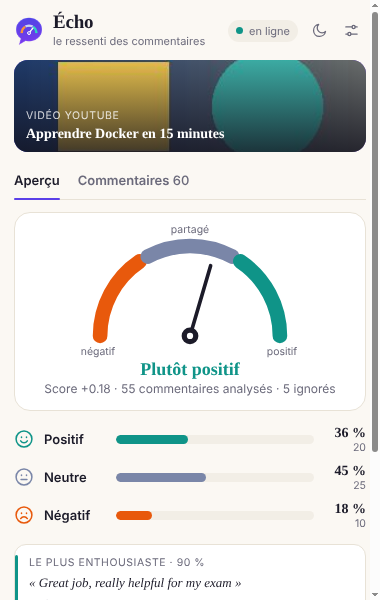
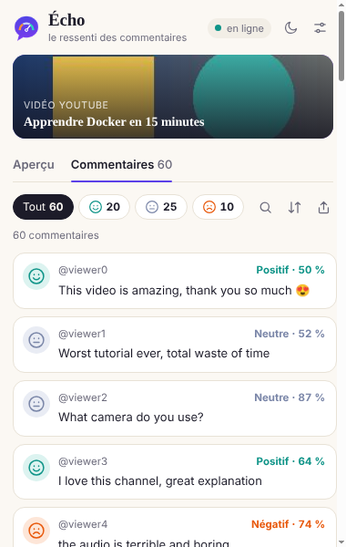
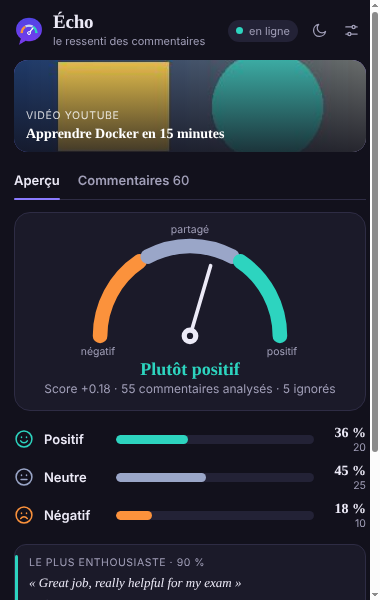
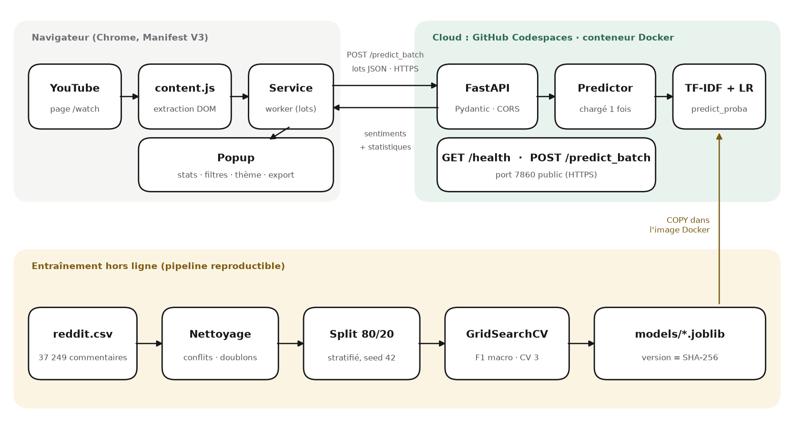

#  Écho

**Que pense le public de cette vidéo ?** Écho lit les commentaires d'une vidéo YouTube et indique pour chacun s'il est
*positif*, *neutre* ou *négatif*, puis résume le tout dans une jauge.

C'est un modèle scikit-learn servi par une API FastAPI, conteneurisé avec Docker, exécuté sur GitHub Codespaces et consommé par une extension Chrome.

| Aperçu | Commentaires | Mode sombre |
|:---:|:---:|:---:|
|  |  |  |

---

## En trois minutes

```bash
python -m venv venv && venv\Scripts\activate        # macOS/Linux : source venv/bin/activate
pip install -r requirements-dev.txt
python run_pipeline.py                              # télécharge, nettoie, entraîne (~5 min)
uvicorn src.api.main:app --port 7860                # laisser tourner
```

Puis dans Chrome : `chrome://extensions` → **Mode développeur** → **Charger l'extension non empaquetée** → dossier
[`chrome-extension/`](chrome-extension/). Ouvrez une vidéo, cliquez sur la bulle **Écho**, puis **Écouter les commentaires**.

<sub>Windows : en cas d'erreur `metadata-generation-failed`, utilisez Python 3.12 (`py -3.12 -m venv venv`) ; en cas d'erreurs `LokyProcess`, lancez `python run_pipeline.py --n-jobs 1`.</sub>

## Ce que fait l'extension

- **Écoute** les commentaires : défile la page pour les charger (20 à 1 000), réponses dépliées en option.
- **Travaille en arrière-plan** : on peut fermer la fenêtre pendant l'analyse ; le résultat est gardé pour chaque vidéo.
- **Aperçu** : jauge à aiguille du score (-1 à +1), verdict en mots, part de chaque sentiment, commentaire le plus enthousiaste et le plus critique.
- **Commentaires** : cartes avec un visage par sentiment et la confiance du modèle, filtres, recherche, tri par confiance.
- **Exporte** la vue affichée : presse-papiers, CSV (Excel) ou JSON. Mode sombre/clair mémorisé.

Guides : [installation](docs/INSTALLATION_EXTENSION.md) · [utilisation](docs/GUIDE_UTILISATEUR.md)

## Comment ça marche



**Dans le navigateur.** `content.js` charge et lit les commentaires ; le service worker (`background.js`) les envoie par
lots de 100 à l'API et range le résultat dans `chrome.storage` ; le popup affiche la progression puis les résultats.

**Dans le cloud.** L'API FastAPI valide la requête, nettoie chaque texte avec **la même fonction qu'à l'entraînement**,
vectorise (TF-IDF) et prédit (régression logistique). Le modèle est chargé une seule fois au démarrage.

**Hors ligne.** `run_pipeline.py` télécharge le dataset Reddit, retire les textes vides, contradictoires et en double,
sépare 80/20 (stratifié, graine 42), cherche les meilleurs hyperparamètres (GridSearchCV, F1 macro) et compare plusieurs
algorithmes. Le modèle est versionné par l'empreinte SHA-256 de ses fichiers.

## Résultats

Test set de 7 298 commentaires, jamais vus pendant l'entraînement :

| | Accuracy | F1 macro | F1 négatif | F1 neutre | F1 positif |
|---|---:|---:|---:|---:|---:|
| **Régression logistique** (retenue) | **89,2 %** | **0,882** | 0,818 | 0,929 | 0,899 |
| SVM linéaire calibré | 89,3 % | 0,881 | | | |
| Random Forest | 78,1 % | 0,729 | | | |
| Naive Bayes multinomial | 65,1 % | 0,608 | | | |
| Baseline (classe majoritaire) | 43,1 % | 0,201 | | | |

Inférence de 50 commentaires : **1,5 ms (p95)** pour une limite de 100 ms. Tous les critères du cahier des charges
sont atteints (accuracy ≥ 80 %, F1 > 0,75 par classe).
Détails : [rapport de performance](reports/performance_report.md) · [rapport technique PDF](reports/rapport-technique.pdf)

## L'API

| | |
|---|---|
| `GET /health` | état, modèle chargé, version |
| `POST /predict_batch` | 1 à 1 000 textes → sentiment, confiance, probabilités, statistiques |
| `POST /predict` | un seul texte |
| `GET /docs` | documentation interactive |

```bash
curl -X POST http://localhost:7860/predict_batch -H "Content-Type: application/json" \
     -d '{"comments": ["This tutorial was helpful!", "Worst video ever", "!!!"]}'
```

Un texte vide après nettoyage (`"!!!"`) revient avec `"skipped": true` et ne compte pas dans les pourcentages.
Toutes les règles et codes d'erreur : [docs/API.md](docs/API.md).

## Mise en ligne sur GitHub Codespaces

1. Poussez le dépôt **avec `models/*.joblib`**.
2. **Code → Codespaces → Create codespace on main.** Rien d'autre à faire : `.devcontainer/` installe Docker et lance
   [`scripts/start_api.sh`](scripts/start_api.sh) à chaque démarrage (build, conteneur, port 7860 public). L'URL
   s'affiche dans `/tmp/start_api.log`.
3. Donnez cette URL à l'extension (réglages d'Écho) ou empaquetez-la directement :
   `python scripts/package_extension.py --api-url https://<nom>-7860.app.github.dev` → `dist/echo-extension-v3.0.0.zip`.

Le Codespace s'endort après ~30 min sans activité ; le rouvrir suffit, l'API redémarre seule.

## Pour aller plus loin

```bash
pytest                                   # 41 tests : nettoyage, modèle, API
npm test                                 # 10 tests : fonctions de l'extension (Node 18+)
API_URL=https://<nom>-7860.app.github.dev pytest tests/test_api.py   # contre l'API en ligne
python -m src.models.benchmark           # latence pour 1, 50, 250, 1000 commentaires
python scripts/build_report.py --auteurs "Prénom Nom"                # rapport PDF
```

| Dossier | Contenu |
|---|---|
| `chrome-extension/` | manifest, `content.js`, `background.js`, popup, `lib.js`, `config.js` |
| `src/data/` · `src/models/` | téléchargement, nettoyage, EDA · entraînement, évaluation, benchmark |
| `src/api/` · `src/utils/` | FastAPI, schémas Pydantic, prédicteur · configuration, logs, nettoyage partagé |
| `models/` · `reports/` | artefacts `.joblib` + métadonnées · métriques, figures, rapport PDF |
| `scripts/` · `.devcontainer/` | démarrage de l'API, rapport, empaquetage · configuration du Codespace |
| `docs/` | API, installation, guide, [réponses aux questions de réflexion](docs/REPONSES_QUESTIONS.md), [déroulé de la vidéo](docs/SCRIPT_VIDEO_DEMO.md) |
