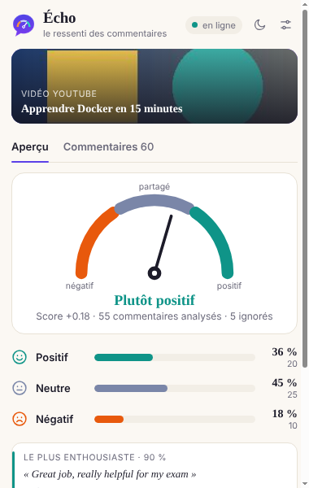
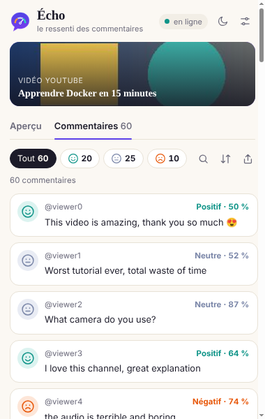
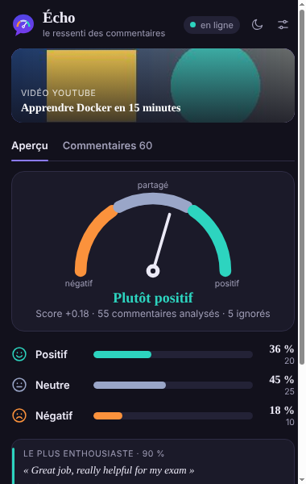

# Guide utilisateur d'Écho

> Les captures fournies proviennent d'une page de test : remplacez `docs/screenshots/overview-light.png`,
> `comments-light.png` et `overview-dark.png` par des captures sur une vraie vidéo.

## 1. Lancer une analyse

1. Ouvrez une vidéo YouTube (`youtube.com/watch?v=…`).
2. Cliquez sur l'icône **Écho** (la bulle avec une jauge). La miniature et le titre de la vidéo s'affichent dans la bannière ; la pastille en haut indique si l'API est **en ligne**.
3. Cliquez sur **Écouter les commentaires**.
   - Écho fait défiler la page pour charger les commentaires, jusqu'au nombre choisi dans les réglages (100 par défaut).
   - L'anneau de progression avance à chaque lot de 100 commentaires analysés.
   - **Vous pouvez fermer la fenêtre** : l'analyse continue ; rouvrez Écho pour voir le résultat.

## 2. Onglet « Aperçu »

- **La jauge** : l'aiguille indique le score global, de *négatif* (à gauche) à *positif* (à droite). Score = (positifs − négatifs) / commentaires analysés.
- **Le verdict** en mots : *Très positif*, *Plutôt positif*, *Avis partagés*, *Plutôt négatif* ou *Très négatif*.
- **Trois lignes** : part et nombre de commentaires positifs, neutres et négatifs. Les commentaires sans texte exploitable (« !!! ») sont « ignorés » et exclus des pourcentages.
- **Le plus enthousiaste / le plus critique** : les deux commentaires dont le modèle est le plus sûr.
- En bas : temps de réponse de l'API, temps total, confiance moyenne, version du modèle, et **Relancer**.

## 3. Onglet « Commentaires »

- Chaque carte montre un visage (souriant, neutre, mécontent), l'auteur, le sentiment et la confiance. Survolez une carte pour voir les trois probabilités ; cliquez sur un texte long pour le déplier. Les réponses portent l'étiquette « réponse ».
- **Filtres** : *Tout* ou un visage pour ne garder qu'un sentiment (avec le nombre de commentaires).
- 🔍 **Rechercher** un mot ou un auteur.
- ⇅ **Trier** : chaque clic passe de l'ordre de la page à la confiance décroissante, puis croissante (pratique pour repérer les cas douteux).
- ⇪ **Exporter** (porte sur la vue affichée, filtres compris) : copier dans le presse-papiers, télécharger en CSV (compatible Excel) ou en JSON.

## 4. Réglages et thème

- Bouton ☾ / ☀ : mode sombre ou clair (mémorisé ; par défaut celui du système).

- Bouton des réglages : adresse de l'API (**Tester la connexion** vérifie `/health`), nombre maximum de commentaires (curseur, 20 à 1 000), chargement en faisant défiler, inclusion des réponses dépliées.

Les analyses sont conservées par vidéo (les 15 dernières) : en rouvrant Écho sur une vidéo déjà analysée, le résultat réapparaît immédiatement.
