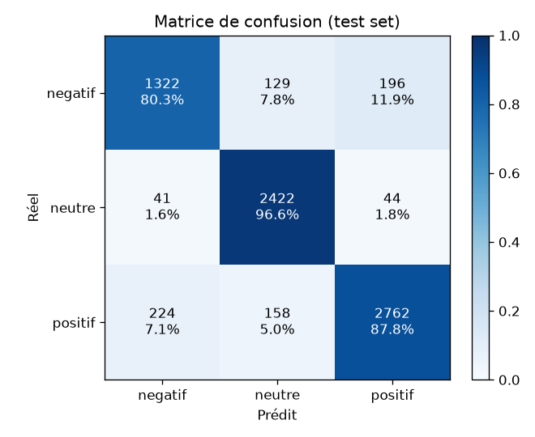
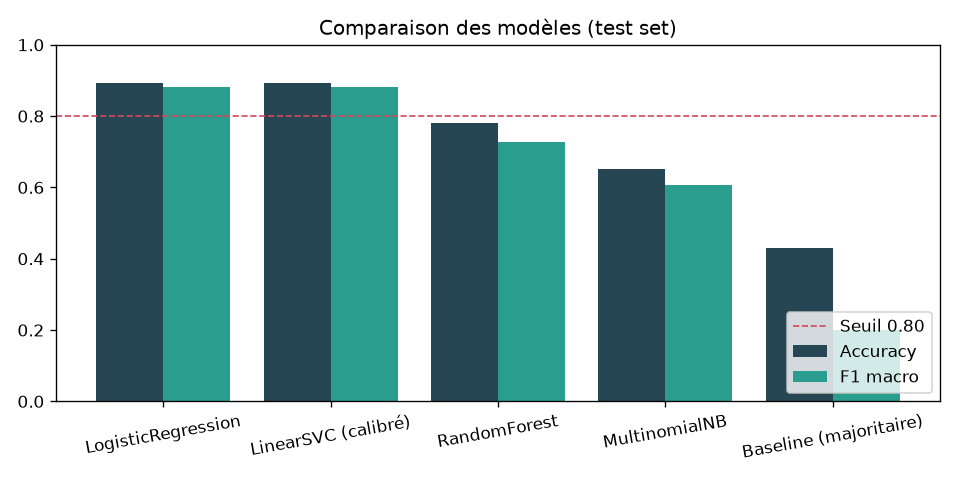

# Rapport de performance du modèle

**Modèle retenu : LogisticRegression** (critère : F1 macro sur le test set)

## Comparaison des modèles

| Modèle | Accuracy | F1 macro | F1 négatif | F1 neutre | F1 positif | Inférence 50 commentaires (ms) |
|---|---|---|---|---|---|---|
| LogisticRegression | 0.8915 | 0.8817 | 0.8176 | 0.9287 | 0.8988 | 0.9 |
| LinearSVC (calibré) | 0.8930 | 0.8805 | 0.8077 | 0.9300 | 0.9037 | 1.8 |
| RandomForest | 0.7809 | 0.7285 | 0.5148 | 0.8637 | 0.8072 | 13.1 |
| MultinomialNB | 0.6513 | 0.6082 | 0.4763 | 0.6390 | 0.7094 | 1.5 |
| Baseline (majoritaire) | 0.4308 | 0.2007 | 0.0000 | 0.0000 | 0.6022 | 0.7 |

## Rapport de classification (modèle retenu)

```
              precision    recall  f1-score   support

     negatif     0.8330    0.8027    0.8176      1647
      neutre     0.8941    0.9661    0.9287      2507
     positif     0.9201    0.8785    0.8988      3144

    accuracy                         0.8915      7298
   macro avg     0.8824    0.8824    0.8817      7298
weighted avg     0.8915    0.8915    0.8907      7298

```

## Matrice de confusion





## Meilleurs hyperparamètres (GridSearchCV, 5 premiers)

| Paramètres | F1 macro CV | Écart-type |
|---|---|---|
| `{'clf__C': 10.0, 'clf__class_weight': 'balanced', 'tfidf__max_features': 50000, 'tfidf__ngram_range': (1, 1)}` | 0.8660 | 0.0026 |
| `{'clf__C': 10.0, 'clf__class_weight': 'balanced', 'tfidf__max_features': 20000, 'tfidf__ngram_range': (1, 1)}` | 0.8660 | 0.0026 |
| `{'clf__C': 10.0, 'clf__class_weight': None, 'tfidf__max_features': 20000, 'tfidf__ngram_range': (1, 1)}` | 0.8643 | 0.0021 |
| `{'clf__C': 10.0, 'clf__class_weight': None, 'tfidf__max_features': 50000, 'tfidf__ngram_range': (1, 1)}` | 0.8643 | 0.0021 |
| `{'clf__C': 5.0, 'clf__class_weight': 'balanced', 'tfidf__max_features': 20000, 'tfidf__ngram_range': (1, 1)}` | 0.8621 | 0.0010 |

## Mots les plus influents par classe (LogReg)

- **negatif** : hate, stupid, bad, other, fuck, wrong, down, mean, evil, fucked, worst, fucking, fake, sad, pathetic
- **neutre** : cockroach, jobless, recap, chennai, proportions, photoshopped, massive, sharpen, respected, misery, arr, internal, gujaratis, scholar, insurance
- **positif** : more, good, best, lol, great, right, many, win, own, most, better, kind, first, love, true
